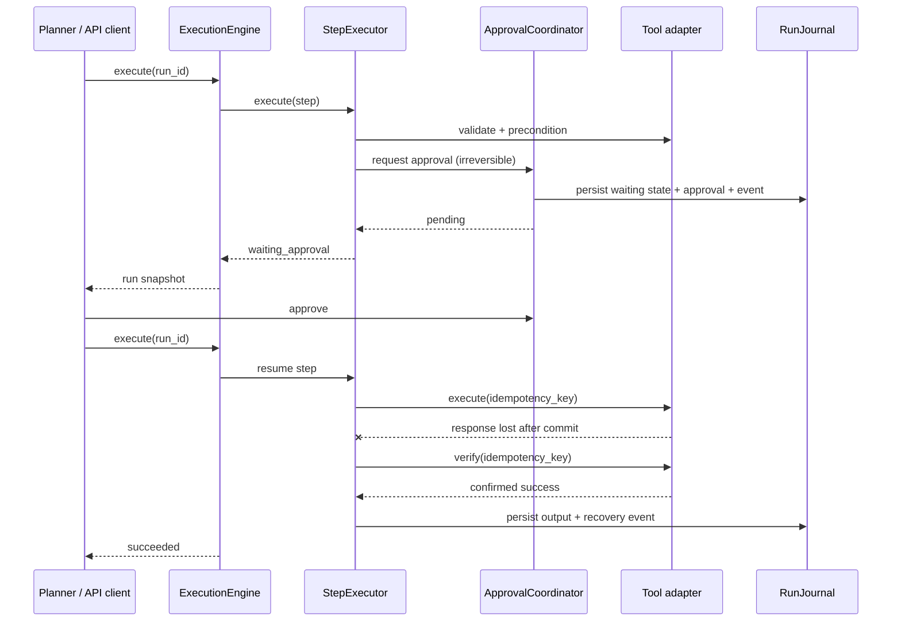

# Architecture

## Design goal

Reliable Agent Runtime separates **planning** from **execution**. An LLM,
workflow engine, or deterministic service may submit one adaptive action or a
short `ExecutionPlan`; the runtime turns that proposal into auditable state
transitions and tool calls.

This boundary keeps model churn out of reliability-critical code and lets the
same runtime be evaluated with different planners.

The runtime does not require an open-ended agent to freeze its whole future
trajectory. The `ActionService` wraps one planner-proposed tool call in the same
durable run semantics; after receiving the outcome, the planner may branch,
clarify, or replan. A short DAG remains available when multiple operations share
a compensation or ordering invariant.

## Dependency rule

```text
api  ───────────────► application ◄──────────── infrastructure
                           │                         │
                           ▼                         │
                         domain ◄────────────────────┘
```

- `domain` has no FastAPI, SQLAlchemy, or concrete model SDK dependencies.
- `application` depends on ports and domain types.
- `infrastructure` implements storage, locking, clock, scheduling, and tools.
- `api` translates HTTP contracts to application use cases.
- `bootstrap.py` is the only composition root.

## Cohesive execution components

| Component | Single responsibility |
|---|---|
| `ActionService` | One-action convenience for adaptive planners |
| `ExecutionEngine` | Run lifecycle and short-DAG traversal |
| `StepExecutor` | One step's validation, policy, retry, and state transitions |
| `ToolInvoker` | Timeout, adapter exception normalization, verification |
| `ApprovalCoordinator` | Human approval creation and lookup |
| `CompensationCoordinator` | Reverse-order rollback of completed writes |
| `RunJournal` | Version advancement and atomic aggregate/event persistence |
| `RunService` | Create, query, and decide approval use cases |

No component imports or instantiates a concrete retail tool. Tool resolution is
through `ToolRegistry`, persistence through `RuntimeStore`, policy through
`PolicyEngine`, and timing through `Clock`/`Sleeper`.

## Execution sequence



## Reliability invariants

### Stable call identity

Each `(run, step, resolved arguments)` receives a deterministic call ID and
idempotency key. A retry or process restart reuses that identity.

### Fail closed on ambiguous side effects

After a timeout or `UnknownToolOutcome`, the runtime asks the adapter to verify
external state. It retries only when the action is confirmed not applied or the
same logical call is safe to repeat.

### Fresh preconditions

Preconditions are checked immediately before execution rather than trusted
from stale planner context.

### Explicit authority boundary

Irreversible tools are blocked by default until a human approval record exists.
The decision is persisted independently and appended to the audit stream.

### Compensation is not magic rollback

Compensation is adapter-defined, best effort, and recorded step by step. A run
is marked `failed_compensated` only when every eligible prior side effect was
successfully reversed.

### Optimistic concurrency

`RunJournal` advances one aggregate version per atomic save. The SQL store
updates only the expected version and raises a typed conflict otherwise. The
same in-memory run lock serializes execution and approval decisions inside one
process; distributed deployments require a distributed lease or queue
partitioning by run ID.

### Explicit DAG result semantics

A successful plan with one sink returns that sink's normalized output. A plan
with multiple sinks returns a `steps` object keyed by sink step ID. This avoids
silently choosing an arbitrary "last" branch in a valid DAG.

## Persistence model

The reference SQL store keeps:

- one aggregate snapshot per run for simple recovery;
- indexed status/version fields for operational queries;
- append-only sequenced events for audit;
- approval records with one-time decisions.

The v0.1 reference implementation uses `create_all` for a frictionless demo.
Production systems should add schema migrations before upgrades.

## Architecture decisions

- [ADR 0001: Separate planning from reliable execution](adr/0001-separate-planning-from-execution.md)
- [ADR 0002: Use idempotency and verification instead of exactly-once claims](adr/0002-use-verification-not-exactly-once-claims.md)
